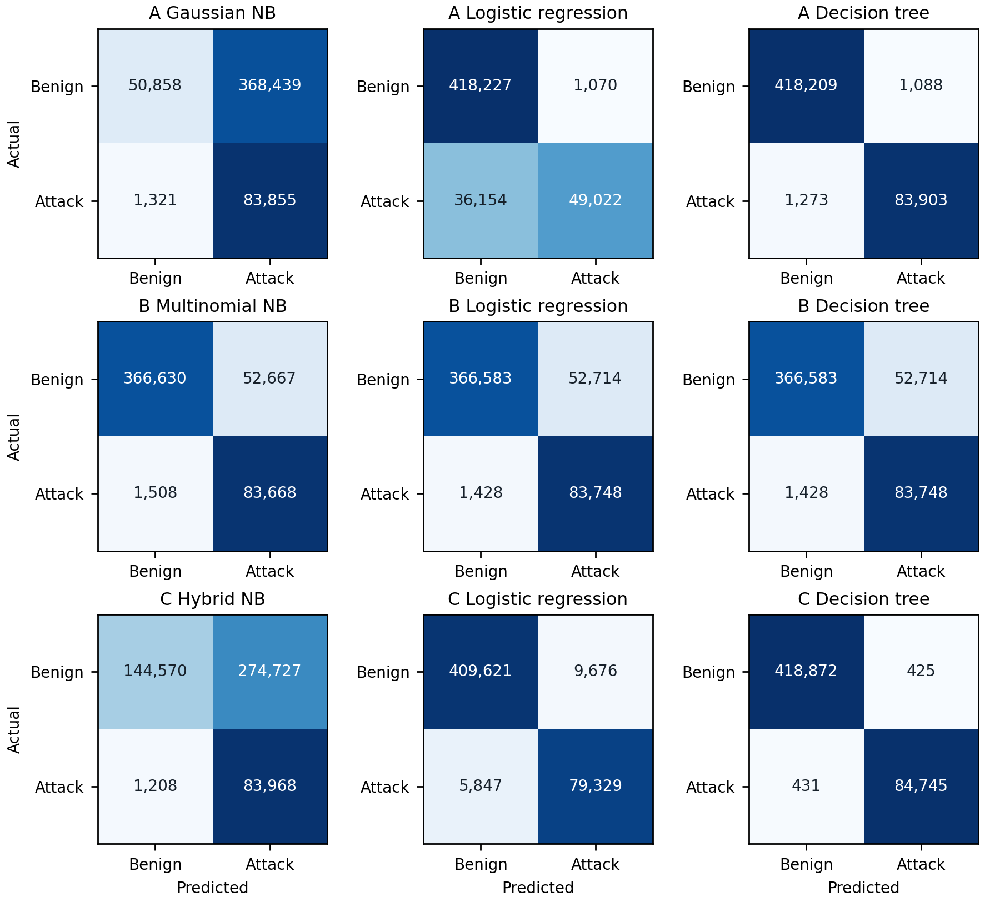

# CICIDS2017 intrusion detection

An end-to-end machine learning study of network intrusion detection using the CICIDS2017 flow dataset. The project moves from data provenance and leakage-aware auditing to reproducible baselines, probabilistic classifiers, tree ensembles, and multiclass attack recognition.

I built this as a sequence of three connected labs, but the result is closer to a complete applied ML project: one fixed evaluation protocol, explicit preprocessing rules, experiment evidence, and a final comparison across model families.

## What I worked on

- Audited more than 2.8 million labeled network flows for malformed rows, duplicates, class imbalance, non-finite values, redundant features, and possible label proxies.
- Created stable row identifiers and a fixed 60/20/20 stratified train-validation-test split for 2,522,362 modeled flows.
- Compared logistic regression, naive Bayes, decision trees, bagging, random forests, gradient boosting, and XGBoost.
- Kept preprocessing decisions training-only and reused the same observations across experiments.
- Evaluated both binary attack detection and multiclass attack-family recognition.
- Studied the effect of destination-port encoding, feature importance, model size, fit time, and prediction time.

## Selected results

On the held-out binary test set, the selected random forest reached **0.9988 balanced accuracy** and **0.9973 attack F1**. In the budgeted multiclass comparison, XGBoost with destination-port encoding reached **0.8330 macro F1**.

These scores belong to the CICIDS2017 experimental setting. The notebooks explicitly discuss dataset artifacts and proxy features, so they should not be read as evidence of production performance on a different network.



More figures and the exact result tables are available under [`results/`](results/).

## Project structure

```text
notebooks/
  01-data-audit-and-baselines.ipynb
  02-classification.ipynb
  03-tree-ensembles.ipynb
src/
  deadline_helpers.py
  build_deadline_report.py
results/
  figures/
  tables/
reports/
  lab-1.pdf
  lab-2.pdf
  lab-3.pdf
data/
  README.md
```

## Reproduce the analysis

1. Create a Python environment and install the dependencies:

   ```bash
   python -m venv .venv
   source .venv/bin/activate
   pip install -r requirements.txt
   ```

2. Download the CICIDS2017 machine-learning CSV files and follow the layout in [`data/README.md`](data/README.md).

3. Run the notebooks in order. The later notebooks reuse the fixed protocol established earlier.

The complete experiments are computationally demanding: the source dataset contains millions of flows, and some ensemble searches were intentionally run with explicit resource budgets.

## Dataset credit

The data were created by the Canadian Institute for Cybersecurity at the University of New Brunswick. If you use CICIDS2017, cite the dataset authors and the accompanying paper listed on the [official dataset page](https://www.unb.ca/cic/datasets/ids-2017.html).

The dataset itself is not redistributed in this repository.
